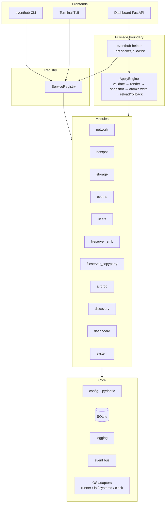

# Architecture

EventHub is a Python package (`src/eventhub`) with one subpackage per concern.
Every front end (CLI, TUI, dashboard) and the privileged helper talk to the
same `ServiceModule` interface through the registry.  No front end shells out
directly.

## Data flow of an apply

1. The dashboard sends an allow-listed action to the root helper over a unix
   socket (no raw shell).
2. The helper validates the complete config with pydantic and by calling every
   enabled module's `validate()`.
3. Each module's `render(config)` returns `RenderedFile` objects (hostapd.conf,
   dnsmasq.conf, nftables rules, smb.conf, copyparty config, Avahi services,
   systemd units…).  Nothing is written yet.
4. `ApplyEngine` copies every target file that already exists into a snapshot
   under `/var/lib/eventhub/snapshots/<id>/`, recording modes and missing files.
5. Files are written atomically (`temp file → fsync → os.replace`), then each
   module's `apply()` reloads its daemon.
6. On any failure the snapshot is restored, `systemctl daemon-reload` runs, and
   the previously applied services are restarted with the old configuration.

## One source of truth

`/etc/eventhub/config.yaml` (validated by `eventhub.core.config.AppConfig`) is
the only declarative source.  Runtime facts that must survive restarts and are
not service configuration (users, password hashes, event rows, access matrix,
sessions, audit history) live in `/var/lib/eventhub/eventhub.db`.

## Module boundary

`eventhub.service_api.ServiceModule` defines:

| Method | Purpose |
| --- | --- |
| `validate(config)` | Return typed validation issues (warnings do not block). |
| `render(config)` | Return `RenderedFile` objects, never write files. |
| `apply()` | Reload the daemon after files are committed. |
| `start()/stop()/restart()` | Lifecycle of the module's systemd units. |
| `status()` | `ServiceStatus` (installed, enabled, running, health). |
| `health_check()` | An active check (port, mount, socket, …). |

Modules receive a `Runtime` with injected adapters (`Runner`, `FileSystem`,
`Systemd`, `Clock`, `Database`, `EventBus`).  Tests pass in-memory fakes, so
the suite runs on any laptop.
